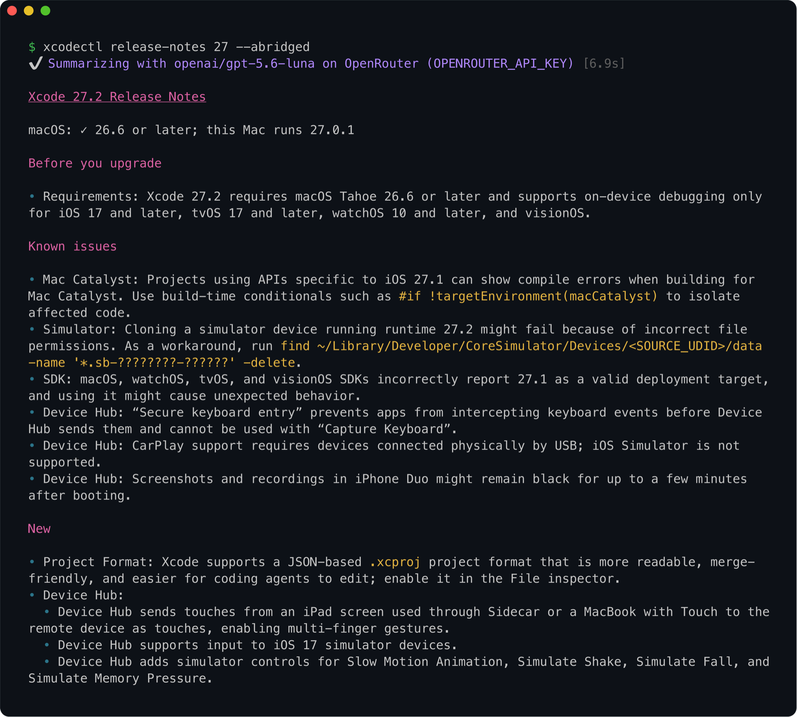

# xcodectl

Install, upgrade and switch Xcode versions and their simulator runtimes from the terminal, on your
Mac and on self-hosted CI Macs. Sign in once on Apple's own page; xcodectl keeps the session in
your Keychain and does the rest.

## ✨ Features

- **Sign-in that keeps working.** You sign in on Apple's own web page in a small window, with a
  two-factor code or a hardware security key: YubiKey and other FIDO2 keys, PIN and touch. xcodectl
  has no Apple login code of its own to break when Apple changes its sign-in. The session stays in
  your Keychain, never your password and never on disk, and the next sign-in usually needs no input.
- **Fast downloads.** 16 parallel connections built in, resumable after an interruption, expanded
  in process with [unxip](https://github.com/saagarjha/unxip). Several versions download and expand
  at once.
- **Upgrades in one command.** `xcodectl upgrade` moves each installed Xcode to the newest release of
  its major, with simulator runtimes for the platforms you have. It removes the old Xcode with the
  runtimes only it used and selects the new one if the old one was. `--dry-run` shows what would
  change.
- **Ready to use after install.** `install` accepts the license, runs the first launch, enables
  developer mode and brings the Command Line Tools up to date.
- **Simulator runtimes.** List, install, remove and prune them, most without signing in, including
  the iOS 18 runtimes that Xcode 27 no longer downloads. `runtime prune` finds the leftovers that
  `simctl` hides while they still hold gigabytes.
- **Knows what runs on your Mac.** `list` shows the macOS versions each Xcode runs on and whether
  yours is one of them.
- **Release notes in the terminal.** In color, compared between two versions, summarized for app
  developers or answered by a model of your choice.
- **Built for CI and agents.** One pipe moves the session to a runner. `--json` output for scripts, a
  config file for defaults, and `xcodectl reference` prints the help of every command at once.
- **One file, run as you.** A single self-contained binary for Apple Silicon. It asks for `sudo`
  only for the steps that need it, and keeps its own files in `~/.xcodectl/` and
  `~/.config/xcodectl/`.

## Compared to xcodes

[xcodes](https://github.com/XcodesOrg/xcodes) is the established tool for the job. xcodectl does
the same core work; this is where they differ:

| | xcodectl | xcodes |
| --- | --- | --- |
| Sign-in | Apple's own page in a window | its own implementation of Apple's login, [fixed again in 2.1.0](https://github.com/XcodesOrg/xcodes/releases/tag/2.1.0) after Apple changed it |
| Hardware security keys | YubiKey and other FIDO2 keys | not supported ([#279](https://github.com/XcodesOrg/xcodes/issues/279), open since 2023) |
| Kept in the Keychain | the session | your Apple ID password |
| CI runner | gets a signed-in session: `auth export \| ssh runner xcodectl auth import` | `XCODES_USERNAME` and `XCODES_PASSWORD` |
| 16-connection downloads | built in, resumable | with aria2 installed |
| Fast unxip | always | `--experimental-unxip` |
| Upgrade in place | `upgrade`, runtimes included | no |
| Release notes | rendered, compared, summarized | no |
| Intel Macs | no | yes |
| GUI app | no | [Xcodes.app](https://github.com/XcodesOrg/XcodesApp) |

## 📦 Install

```sh
mise use -g github:bonkey/xcodectl
# or
brew install bonkey/tap/xcodectl
# or from source
git clone https://github.com/bonkey/xcodectl && cd xcodectl && just install
```

Shell completion covers commands, options and the installed versions:

```sh
eval "$(xcodectl --generate-completion-script zsh)"    # ~/.zshrc, after compinit
eval "$(xcodectl --generate-completion-script bash)"   # ~/.bashrc
xcodectl --generate-completion-script fish > ~/.config/fish/completions/xcodectl.fish
```

## Usage

```sh
xcodectl auth login                      # a window opens: sign in with your Apple ID
xcodectl list                            # versions Apple offers, and which run on this Mac
xcodectl install 27.1                    # download, expand, approve, Command Line Tools
xcodectl select 27.1                     # xcode-select (sudo)
xcodectl upgrade                         # newest release of each installed major; the old one goes
xcodectl installed                       # what is installed, with sizes and runtimes
xcodectl remove 27.0                     # with the runtimes no other Xcode uses
xcodectl release-notes 27 --abridged     # what changed, for app developers
xcodectl runtime install ios             # the runtime matching the active Xcode
```

Versions are forgiving: `26.1`, `27`, `27 rc`, `27 beta 3`, `27A266a`, `latest`, `latest-beta`.
Leave the version out of `install`, `approve` or `select` for a picker. `xcodectl <command> --help` lists the flags, and
`xcodectl reference` prints the help of every command at once.

When the session is missing or Apple no longer accepts it, `install`, `upgrade`,
`runtime install`, `auth status` and `auth export` open the sign-in window and carry on; `--no-login` makes them fail instead. Passkeys
stored in iCloud Keychain do not work in the window.

```
$ xcodectl list
VERSION     BUILD     RELEASED    STATUS     MACOS
27.2-beta3  27B5038j  2026-10-14             ✓ 26.6 or later
27.1        27A9275   2026-10-15  installed  ✓ 26.6 or later
27.1-beta1  27A9269   2026-09-18  installed  ✓ 26.6 or later
27.0        27A266a   2026-09-14  * active   ✓ 26.6 or later
26.6        17F113    2026-06-25             ✗ 26.2–26.x
```

`--stable` and `--beta` narrow the list, `--by-date` sorts it by release, and a regex searches every
version: `xcodectl list '^16\.'`.

```
$ xcodectl installed
VERSION     BUILD     SIZE    PATH
27.2        27B5019j  3.3 GB  /Applications/Xcode-27.2-beta1.app  * active
  iOS 27.2  24B5084k  7.6 GB
27.1        27A9269   3.3 GB  /Applications/Xcode-27.1-beta1.app
  iOS 27.1  24A94401  7.3 GB
27.0        27A266a   3.3 GB  /Applications/Xcode-27.0.app
  iOS 27.0  24A434    7.5 GB
```

## 📝 Release notes

No login needed.

```sh
xcodectl release-notes 27                  # rendered in color, with clickable links
xcodectl release-notes 26.3 26.4           # what 26.4 adds (+) and drops (-)
xcodectl release-notes 27 --abridged       # what an app developer needs before upgrading
xcodectl release-notes 27 --ask "which minimal macOS is required?"
```



`--abridged` and `--ask` send the notes to a model on OpenRouter, OpenAI or Gemini, with the key in
`OPENROUTER_API_KEY`, `OPENAI_API_KEY` or `GEMINI_API_KEY`, or to a server of your own, such as
Ollama. A model can get things wrong, so check the notes before you act on what it says.

<details>
<summary>Model options</summary>

```
--key-env MY_KEY               read the API key from another environment variable (goes to OpenAI
                               unless --provider says otherwise)
--provider openai|openrouter|gemini
                               use this provider's key although another one is set too
--model <id>                   use this model
--base-url <url> --model <id>  another OpenAI-compatible API; needs no key
```

For Ollama:

```sh
xcodectl release-notes 27 --abridged --base-url http://localhost:11434/v1 --model <model>
```

Long notes hold about 15k tokens, more than Ollama reads by default: raise its context, for example
with `OLLAMA_CONTEXT_LENGTH=32768`.

</details>

## Simulator runtimes

No login needed from iOS 18, tvOS 18, watchOS 11 and visionOS 2 on. Older ones, back to iOS 16,
tvOS 16, watchOS 9 and visionOS 1, download with your Apple session.

```sh
xcodectl runtime list                        # what Apple offers
xcodectl runtime install ios 17              # the newest iOS 17 release
xcodectl install 27.1 --runtimes ios,watchos # Xcode and its runtimes in one go
xcodectl runtime prune --dry-run             # leftovers simctl hides, and the space they hold
xcodectl upgrade --replace-runtimes          # also delete runtimes no installed Xcode uses
```

Xcode 27 no longer downloads runtimes older than iOS 26. Through Xcode 27, xcodectl fetches the
iOS 18, tvOS 18, watchOS 11 and visionOS 2 runtimes from Apple's public asset server itself. Such a
runtime takes about twice its size on disk: 16.5 GB for iOS 18.6.

## 🤖 CI

Move the session from your Mac to a self-hosted runner once, then install in the job:

```sh
xcodectl auth export | ssh runner xcodectl auth import
```

```sh
xcodectl install 27.1 --select
```

`auth export --copy` and `auth import --paste` do the same through the clipboard. Both ask Apple
whether the session still holds first. To keep the session off the runner's Keychain, pass the
exported blob per job as `XCODECTL_SESSION`; it stays in memory.

Apple's session lasts from a day to a few weeks. `xcodectl auth status` exits 1 when it has expired,
and `xcodectl auth export` signs you in again.

<details>
<summary>The login Keychain over ssh</summary>

Over ssh the login Keychain is locked, because macOS gives each ssh connection its own security
session. `auth import` unlocks it for its own connection while you are logged in at the runner's
console. Other commands that read the session, such as `install`, need `security unlock-keychain`
in the same connection first, or they fail with "User interaction is not allowed". Let ssh share
one connection per host, in `~/.ssh/config` on your Mac:

```
Host runner
    ControlMaster auto
    ControlPath ~/.ssh/cm-%C
    ControlPersist 10m
```

Then one unlock serves every command while the connection lasts:

```sh
ssh -t runner security unlock-keychain    # asks for the runner's login password
xcodectl auth export | ssh runner xcodectl auth import
```

Runners launched in the logged-in session are not affected.

</details>

## Configuration

`xcodectl config init` writes `~/.config/xcodectl/config.toml` (or the path in `XCODECTL_CONFIG`)
with every key commented out. Keys are the flags without `--`, one table per command; keys before
the first table reach every command that has them.

```toml
login = false            # never open the sign-in window

[install]
approve = false          # install --no-approve
runtimes = "ios,watchos"

[list]
order = "by-date"
```

A flag on the command line wins over the file, and every flag the file sets has an inverse, such as
`--approve` for `approve = false`. `xcodectl config check` lists what the file sets, or what is
wrong with it.

## Thanks

Version data comes from [xcodereleases.com](https://xcodereleases.com). Archives expand with
[unxip](https://github.com/saagarjha/unxip), and security keys work through
[libfido2](https://github.com/Yubico/libfido2).
